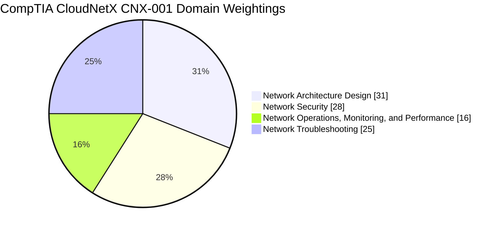
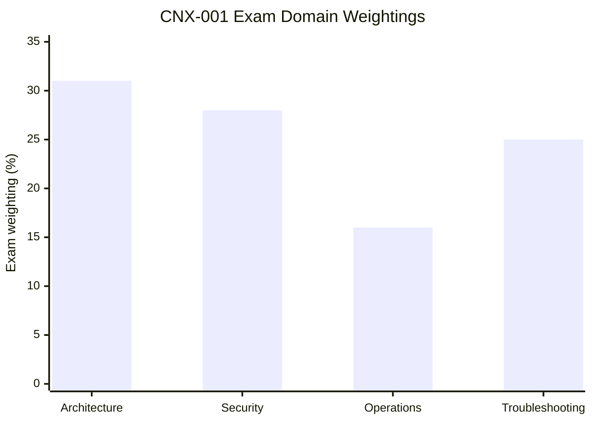
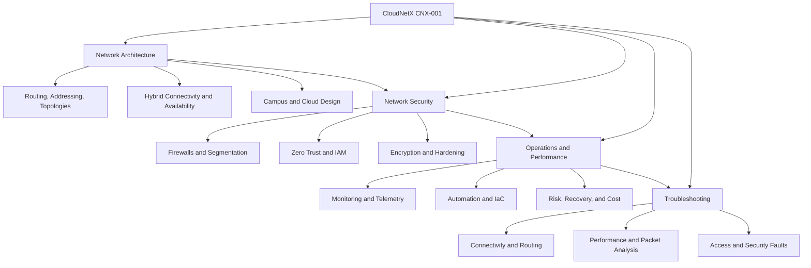
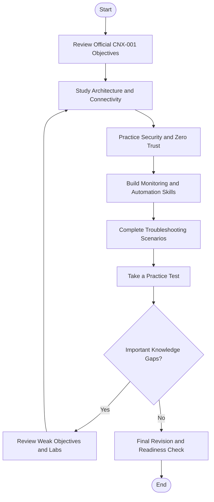
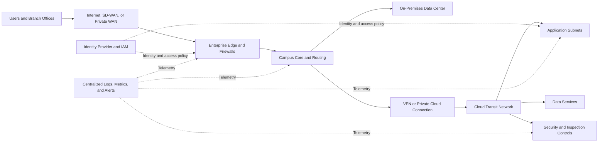
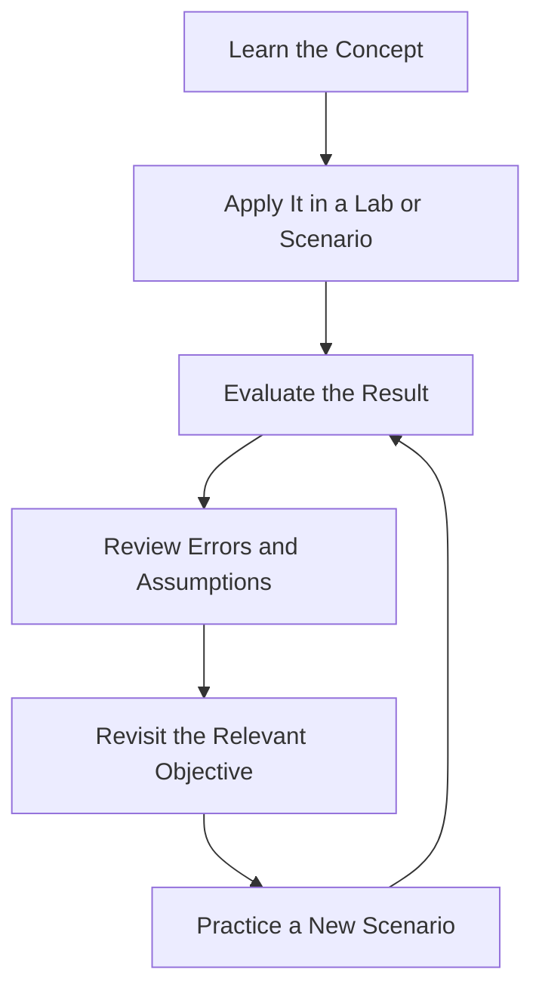
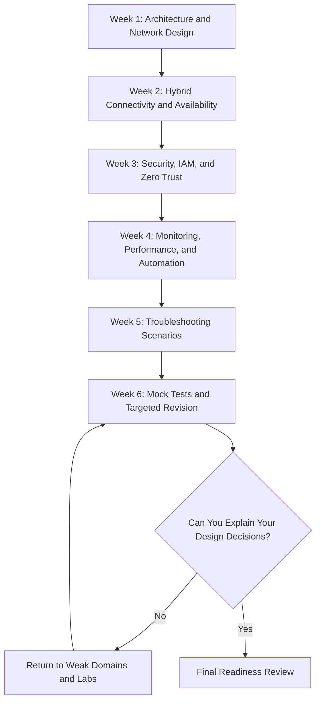

# CompTIA CloudNetX CNX-001 Study Guide

A practical study guide for the **CompTIA CloudNetX CNX-001 certification**, focused on hybrid cloud networking, enterprise network architecture, network security, Zero Trust, monitoring, automation, and troubleshooting.

CloudNetX is an advanced networking certification for professionals who design and evaluate complex network environments spanning on-premises infrastructure and cloud platforms. This repository organizes the exam objectives into a structured study path with technical diagrams, architecture examples, practical labs, and original practice questions.

For supplementary study materials, explore [CertsGate](https://certsgate.com/). Use independent preparation resources alongside the official CompTIA objectives and hands-on technical practice.

## Table of Contents

- [About CompTIA CloudNetX](#about-comptia-cloudnetx)
- [Who Should Use This Guide?](#who-should-use-this-guide)
- [Exam Details](#exam-details)
- [Official Exam Domains and Weightings](#official-exam-domains-and-weightings)
- [CloudNetX Skills Map](#cloudnetx-skills-map)
- [Preparation Flowchart](#preparation-flowchart)
- [Hybrid Cloud Network Architecture](#hybrid-cloud-network-architecture)
- [Study and Revision Cycle](#study-and-revision-cycle)
- [Step-by-Step Preparation Strategy](#step-by-step-preparation-strategy)
- [Suggested Study Roadmap](#suggested-study-roadmap)
- [Hands-On Labs and Projects](#hands-on-labs-and-projects)
- [Practice Questions and Mock Tests](#practice-questions-and-mock-tests)
- [Common Preparation Mistakes](#common-preparation-mistakes)
- [Career Relevance](#career-relevance)
- [Frequently Asked Questions](#frequently-asked-questions)
- [Official and Technical Resources](#official-and-technical-resources)
- [About CertsGate](#about-certsgate)

## About CompTIA CloudNetX

CompTIA CloudNetX is designed for experienced IT professionals working with complex network architecture and hybrid cloud environments. Its focus extends beyond configuring individual network devices: candidates must be able to evaluate business requirements, compare architectural options, select appropriate security controls, and reason through network performance and availability problems.

The CNX-001 exam objectives cover four domains:

- Network Architecture Design
- Network Security
- Network Operations, Monitoring, and Performance
- Network Troubleshooting

These areas connect closely in real environments. For example, a network architect might design private connectivity between a corporate data center and a cloud environment, apply identity-aware access controls, configure monitoring, and define a troubleshooting approach for connectivity failures.

This guide uses those relationships to explain the concepts in context.

**Start with the official source:** [CompTIA CloudNetX certification information](https://www.comptia.org/en-us/certifications/cloudnetx) and the [official CNX-001 exam objectives](https://comptiacdn.azureedge.net/webcontent/docs/default-source/exam-objectives/comptia-cloudnetx-cnx-001-exam-objectives-%281-2%29.pdf).

## Who Should Use This Guide?

This repository is most useful for:

- Network architects designing enterprise and hybrid cloud networks.
- Cloud architects responsible for connectivity and network security.
- Infrastructure architects evaluating availability, performance, and operational requirements.
- Senior network engineers preparing for architecture-level responsibilities.
- Network security professionals working with segmentation, IAM, and Zero Trust.
- Experienced IT professionals preparing for the CNX-001 certification.

CompTIA's published objectives recommend at least **10 years of IT experience and five years in a network architect role**, including hybrid cloud experience. Network+, Security+, and Cloud+ or equivalent knowledge are also recommended.

These are recommended experience levels, not a substitute for checking current exam policies. Candidates with less experience may need additional study and practical work before attempting an advanced architecture exam.

## Exam Details

The following information is drawn from CompTIA's published CNX-001 objectives. Confirm current scheduling and delivery details with the provider before booking.

| Detail | Information |
|---|---|
| Certification | CompTIA CloudNetX |
| Exam code | CNX-001 |
| Exam objectives version | Version 1.2 in the linked official PDF |
| Maximum questions | 90 |
| Question types | Multiple-choice and performance-based |
| Exam duration | Verify the current duration with CompTIA before booking |
| Result | Pass/fail; no scaled score |
| Recommended background | Extensive IT and network architecture experience, including hybrid cloud |

The official objectives identify a pass/fail result rather than a numerical scaled passing score. Do not assume that a specific percentage of correct answers guarantees a pass.

## Official Exam Domains and Weightings

CompTIA's published CNX-001 objectives define four domains. Use their weightings to structure preparation while making sure you can apply concepts from every domain.

| Official domain | Exam weighting |
|---|---:|
| 1.0 Network Architecture Design | 31% |
| 2.0 Network Security | 28% |
| 3.0 Network Operations, Monitoring, and Performance | 16% |
| 4.0 Network Troubleshooting | 25% |
| **Total** | **100%** |

### Official domain weightage chart

### Domain comparison chart

These charts reflect the percentages published in the official objectives. They represent domain weighting, not relative difficulty.

### Domain 1.0 — Network Architecture Design (31%)

This is the largest domain. Focus on choosing network designs that satisfy business, technical, security, availability, and regulatory requirements.

Important topics include:

- OSI model, IPv4, IPv6, subnetting, CIDR, and VLSM.
- NAT, PAT, NAT64, DHCP, DNS, NTP, TCP, and UDP.
- Static routing, OSPF, BGP, RADIUS, TACACS+, and LDAP.
- Mesh, star, hub-and-spoke, spine-and-leaf, and point-to-point topologies.
- Trusted, untrusted, and screened network zones.
- VLAN, VXLAN, GENEVE, and network segmentation.
- Hybrid cloud connectivity, VPNs, MPLS, SD-WAN, and direct cloud connections.
- Cloud private connectivity, transit gateways, VPC peering, and private links.
- High availability, redundancy, load balancing, and autoscaling.
- Wired and wireless campus networks, physical infrastructure, and power requirements.
- Architecture documentation, reference designs, runbooks, and configuration management.

The key skill is selecting a suitable architecture from stated requirements and explaining the trade-offs.

### Domain 2.0 — Network Security (28%)

Network design must account for threats, access requirements, and protection of network traffic and resources.

Study:

- DDoS, data exfiltration, on-path attacks, IP spoofing, BGP hijacking, and social engineering.
- Misconfiguration, insecure protocols, unpatched devices, and overly permissive rules.
- Next-generation firewalls, cloud-native firewalls, WAFs, IDS/IPS, and network access control.
- Firewall rules, network ACLs, security groups, and URL filtering.
- Encryption, TLS, certificates, and key management.
- Zero Trust principles, microsegmentation, SASE, SSE, CASB, and ZTNA.
- Identity and access management, MFA, SSO, federation, SAML, OAuth 2.0, and OpenID Connect.
- RBAC, ABAC, privileged access management, and conditional access.
- Wireless security, WPA2, WPA3, guest access, and client isolation.
- Appliance hardening, patch verification, secure administrative access, and remote logging.

For scenario questions, identify the risk first. Then choose a control that directly addresses it without unnecessarily breaking legitimate connectivity.

### Domain 3.0 — Network Operations, Monitoring, and Performance (16%)

This domain concerns maintaining reliable networks, understanding performance, and automating repeatable tasks.

Review:

- Risk management, business continuity, and disaster recovery.
- RTO, RPO, MTTR, MTBF, MTTD, and MTTI.
- SLAs, SLOs, SLIs, KPIs, OLAs, and service management.
- Network function virtualization, proxies, and NAT gateways.
- Capital expenditure, operating expenditure, and network cost optimization.
- Traffic mirroring, throughput, latency, packet loss, jitter, and network flows.
- Centralized logging, syslog, SIEM, SNMP, telemetry, and dashboards.
- QoS, alerting, resource utilization, and continuous monitoring.
- Infrastructure as Code, YAML, JSON, version control, and secrets management.
- APIs, SDKs, command-line interfaces, CI/CD, GitOps, and configuration validation.
- Change management, configuration backups, and desired-state workflows.

Learn to connect metrics with operational decisions. High latency, for example, may require a different investigation from packet loss or insufficient bandwidth.

### Domain 4.0 — Network Troubleshooting (25%)

Troubleshooting represents one-quarter of the published exam weighting. Candidates should be comfortable diagnosing faults across connectivity, performance, access, and security.

Review:

- Structured troubleshooting methodology.
- Identifying symptoms and collecting evidence.
- Testing theories of probable cause.
- OSI-layer troubleshooting and divide-and-conquer approaches.
- DNS, DHCP, routing, VPN, and cloud connectivity issues.
- Packet captures, traffic analysis, and protocol inspection.
- Authentication, certificates, firewall rules, and access failures.
- Latency, throughput, packet loss, jitter, and wireless issues.
- Configuration changes, regression checks, and verification.
- Escalation, documentation, and communicating findings.

Avoid making multiple unverified changes at once. Gather evidence, test one hypothesis, apply a controlled fix, and verify the result.

For the complete scope, use the [official CNX-001 objectives PDF](https://comptiacdn.azureedge.net/webcontent/docs/default-source/exam-objectives/comptia-cloudnetx-cnx-001-exam-objectives-%281-2%29.pdf).

## CloudNetX Skills Map

This independent study map connects the exam's technical areas. It is a conceptual overview, not an alternative official weighting chart.

A useful way to study is to follow a complete scenario: design a network, protect it, monitor its behavior, and determine how you would diagnose a failure.

## Preparation Flowchart

Use this preparation workflow to organize study and measure progress. If important gaps remain after a mock test, return to the relevant objectives and practical exercises.

## Hybrid Cloud Network Architecture

CloudNetX preparation benefits from understanding how enterprise and cloud network components interact. The diagram below is an illustrative hybrid architecture, not an official CompTIA reference design.

When reviewing a network architecture, ask:

1. What are the business requirements for availability, latency, security, and cost?
2. Which systems must communicate, and which should be isolated?
3. Is private connectivity required between the data center and cloud?
4. Where should routing, segmentation, and traffic inspection occur?
5. How are identities, devices, and administrative sessions verified?
6. Which metrics and logs will reveal connectivity or performance failures?
7. How can the design recover from a device, link, or regional failure?

### Architecture decisions to understand

| Requirement | Options to evaluate | Important trade-off |
|---|---|---|
| Private hybrid connectivity | Site-to-site VPN, private cloud connection, SD-WAN | Cost, latency, resilience, and management |
| High availability | Redundant paths, active-active, active-passive | Complexity, failover behavior, and cost |
| Network segmentation | VLANs, VXLAN, security groups, microsegmentation | Isolation, scale, and operational complexity |
| Secure remote administration | Bastion host, VPN, identity-aware access | Exposure, usability, and access control |
| Traffic distribution | Local or global load balancing | Health checks, latency, capacity, and failover |
| Observability | Flow data, logs, packet captures, telemetry | Visibility, retention, cost, and privacy |

No single option is best for every environment. The appropriate choice depends on requirements and constraints.

## Study and Revision Cycle

CloudNetX is best approached through repeated application rather than one-time reading.

Maintain a mistake log containing:

- **Topic:** For example, BGP, VPNs, Zero Trust, or packet loss.
- **Symptom or requirement:** What did the scenario describe?
- **Reasoning:** Why was the chosen solution appropriate or inappropriate?
- **Correction:** What evidence or principle changes the decision?
- **Retest:** Can you solve a new scenario without looking at the notes?

This is especially useful for architecture questions where multiple technologies might work, but only one fits the stated constraints most closely.

## Step-by-Step Preparation Strategy

### Step 1: Map your existing experience to the objectives

Read every objective and identify gaps in architecture, security, operations, and troubleshooting. Be specific: “understand BGP route selection” is more useful than “study routing.”

### Step 2: Strengthen architecture decision-making

Practice translating business requirements into technical designs. Compare routing approaches, hybrid connectivity options, topologies, segmentation, redundancy, and load balancing.

For each design, document:

- Requirements and assumptions.
- Proposed architecture.
- Security and availability controls.
- Cost and operational trade-offs.
- Failure scenarios and recovery behavior.

### Step 3: Review network security and Zero Trust

Study access-control decisions in context. Understand how identity, device trust, segmentation, firewall rules, and least privilege work together.

Practice explaining why a proposed control addresses a specific risk. For example, MFA strengthens authentication, while network segmentation restricts communication paths; they solve different problems.

### Step 4: Build monitoring and automation skills

Use a lab or simulation to collect logs, inspect network traffic, and interpret latency or packet-loss symptoms. Review infrastructure definitions, version control, configuration validation, and secrets management.

You do not need to use every named tool in production to understand the role it plays in an operational workflow.

### Step 5: Troubleshoot from evidence

Use a consistent process:

1. Identify the reported problem and affected systems.
2. Gather logs, metrics, configurations, and user observations.
3. Establish a theory of probable cause.
4. Test the theory with a controlled check.
5. Apply a suitable fix or escalate.
6. Verify end-to-end functionality.
7. Document the root cause and preventive actions.

### Step 6: Use scenario-based practice

Practice questions should require you to evaluate requirements, not simply recall a definition. After each answer, explain why the selected option fits and why the alternatives do not.

Use the official objectives to map every mistake to a topic that needs further study.

### Step 7: Review the full blueprint

Architecture and security account for most of the published weighting, but do not neglect operations or troubleshooting. A balanced understanding is important for an advanced certification focused on designing and supporting complex network environments.

## Suggested Study Roadmap

The following six-week roadmap is an independent planning suggestion, not an official CompTIA schedule. Experienced candidates can adjust it to suit their existing knowledge and available study time.

| Week | Focus | Suggested evidence of progress |
|---|---|---|
| 1 | Architecture foundations | Explain routing, addressing, topologies, and segmentation choices |
| 2 | Hybrid connectivity | Compare VPNs, SD-WAN, private links, and redundancy approaches |
| 3 | Security | Explain IAM, Zero Trust, firewall controls, and hardening |
| 4 | Operations | Interpret metrics and logs; review automation and configuration management |
| 5 | Troubleshooting | Diagnose sample routing, DNS, VPN, performance, and access faults |
| 6 | Consolidation | Take practice tests, review errors, and revisit weak objectives |

Because the recommended experience is advanced, learners who are new to network architecture may need a longer preparation period.

## Hands-On Labs and Projects

Practical work helps connect the exam objectives to real design and operational decisions. Use an authorized lab, network simulator, cloud sandbox, or non-production environment. Do not test changes on production networks without appropriate approval.

### Lab 1: Design a hybrid cloud network

Create a diagram showing a corporate network connected to a cloud environment. Include routing, segmentation, security inspection, identity, and monitoring.

Tasks:

- Define availability and latency requirements.
- Select a connectivity approach.
- Identify trusted and untrusted network zones.
- Plan redundant links or failover.
- Document expected traffic flows.

**Deliverable:** A logical network diagram and a short design rationale.

### Lab 2: Compare VPN and private connectivity

Design two alternative solutions for connecting an on-premises environment to a cloud network.

Compare:

- Security requirements.
- Latency and expected traffic.
- Resilience and failover.
- Operational responsibility.
- Cost and implementation complexity.

**Deliverable:** A comparison table that explains when each approach might be appropriate.

### Lab 3: Review network security controls

Create a hypothetical environment with application, administration, and data networks.

Tasks:

- Define which components must communicate.
- Propose firewall rules and segmentation.
- Identify administrative access requirements.
- Apply least-privilege reasoning.
- Explain how logs would reveal suspicious access.

**Deliverable:** A simplified access-control matrix and security design.

### Lab 4: Monitor network performance

Use a lab environment or sample telemetry to examine latency, throughput, packet loss, and reachability.

Tasks:

1. Establish a baseline.
2. Identify an abnormal metric.
3. Gather supporting logs or packet evidence.
4. Develop a probable cause.
5. Test a hypothesis.
6. Record the result and next steps.

**Deliverable:** A troubleshooting report with symptoms, evidence, cause, and verification.

### Lab 5: Automate a configuration workflow

Use a safe test environment to explore Infrastructure as Code or configuration automation.

Tasks:

- Store configuration files in version control.
- Validate syntax before applying changes.
- Avoid committing credentials or secrets.
- Review changes before deployment.
- Document how to roll back a failed change.

**Deliverable:** A sample workflow and a short explanation of validation and change control.

### Lab 6: Practice an end-to-end incident

Create a scenario where users cannot reach an application hosted in the cloud. Consider DNS, routing, VPN status, firewall rules, identity, and service health.

Work through the troubleshooting methodology and collect evidence before choosing a fix.

**Deliverable:** An incident timeline and a root-cause summary.

These are independent learning exercises, not official CompTIA labs or a claim about the exact performance-based tasks used in CNX-001.

## Practice Questions and Mock Tests

Practice questions are most useful when they develop architectural reasoning and troubleshooting discipline. Avoid treating a question bank as a substitute for the official objectives or practical experience.

For supplementary preparation materials, explore [CertsGate](https://certsgate.com/). Use any relevant study guides, practice questions, or mock tests alongside official documentation and lab work.

### Original practice questions

The questions below are independently written educational examples. They are not official CompTIA questions and do not reproduce live exam content.

#### Question 1: Hybrid connectivity

A company needs a private connection between its data center and a cloud environment. The design must consider resilience, predictable performance, and operational cost. What is the most appropriate next step?

A. Select a connection without reviewing requirements  
B. Compare suitable private connectivity and VPN options against the business requirements  
C. Remove all redundant paths  
D. Expose every internal service directly to the internet

**Correct answer: B**

**Explanation:** The appropriate connection depends on requirements such as bandwidth, latency, resilience, security, cost, and available infrastructure. Comparing options before selecting a design is the sound architectural approach.

#### Question 2: Zero Trust

An organization wants to limit application access based on user identity, device trust, and the specific resource requested. Which approach best aligns with this goal?

A. Trust every device inside the corporate network  
B. Apply identity-aware access decisions and least privilege  
C. Give every user permanent administrator access  
D. Disable authentication for internal applications

**Correct answer: B**

**Explanation:** Zero Trust emphasizes explicit verification and least privilege rather than relying solely on network location.

#### Question 3: Network troubleshooting

Users report intermittent delays when accessing an application. Which action should a network engineer take first?

A. Replace every network device immediately  
B. Collect relevant telemetry and compare latency, loss, and traffic patterns against a baseline  
C. Disable monitoring  
D. Change routing protocols without collecting evidence

**Correct answer: B**

**Explanation:** Measurements and logs help narrow the possible causes. A baseline and targeted evidence support a more reliable diagnosis than uncontrolled configuration changes.

#### Question 4: High availability

A network design must continue providing service if one network path fails. Which design principle directly addresses this requirement?

A. Single-path connectivity  
B. Path redundancy with an appropriate failover mechanism  
C. Removal of health checks  
D. Disabling route monitoring

**Correct answer: B**

**Explanation:** Redundant paths can reduce dependence on a single link. The design also needs suitable failover behavior and testing to confirm recovery.

#### Question 5: Infrastructure automation

An organization wants network configuration changes to be reviewed, versioned, and validated before deployment. Which workflow best supports this objective?

A. Make untracked changes directly to production  
B. Store configuration in version control and validate reviewed changes before applying them  
C. Share administrative secrets in public repositories  
D. Disable change management

**Correct answer: B**

**Explanation:** Version control, review, and validation improve traceability and reduce avoidable configuration errors. Secrets must be managed securely.

### How to review practice answers

After each question:

1. Identify the requirement that matters most.
2. Explain why the correct answer fits that requirement.
3. Identify the trade-off or weakness in each alternative.
4. Map the question to the official exam objective.
5. Review the concept in documentation or a lab.
6. Try a new scenario involving a different constraint.

### Mock-test strategy

- Begin with a diagnostic assessment.
- Use focused practice while learning individual topics.
- Introduce timed practice when you can explain the concepts.
- Track incorrect answers and uncertain guesses.
- Revisit weak objectives and repeat related labs.
- Assess readiness by evaluating your reasoning, not just your score.

No mock test can guarantee the outcome of the actual exam. Be cautious with resources that claim to provide leaked or guaranteed live questions.

## Common Preparation Mistakes

### Studying only device configuration

CloudNetX focuses heavily on architecture decisions. Learn to compare solutions against requirements, including availability, security, performance, cost, and operational complexity.

### Ignoring hybrid connectivity

Review the relationships among enterprise routing, VPNs, private cloud connectivity, SD-WAN, transit networks, and cloud-native connectivity services.

### Treating security as a separate afterthought

Security controls should fit the architecture. Understand how identity, segmentation, encryption, traffic inspection, and monitoring work together.

### Memorizing definitions without applying them

Knowing what BGP, VXLAN, SASE, or ZTNA means is not enough. Practice selecting and evaluating technologies in realistic scenarios.

### Changing configurations before gathering evidence

Uncontrolled changes can make troubleshooting harder. Establish the symptoms, test a probable cause, and verify the fix.

### Neglecting monitoring and automation

Although operations has the smallest weighting, it still represents a published exam domain. Study telemetry, logs, performance measurements, IaC, and change management.

### Using outdated or unauthorized study materials

Check the exam code and objective version for all resources. Avoid unauthorized exam dumps and content claiming to guarantee live questions or a passing result.

## Career Relevance

CloudNetX preparation is relevant to work involving complex enterprise networks and hybrid cloud infrastructure. The skills covered may support responsibilities such as:

- Network and cloud architecture.
- Hybrid cloud connectivity design.
- Network security architecture.
- Infrastructure reliability and availability.
- Network operations and performance monitoring.
- Cloud networking and troubleshooting.
- Infrastructure automation and configuration management.

The value of the certification depends on the responsibilities of a particular role, practical experience, and employer requirements. A certification does not guarantee employment, promotion, or a specific salary.

## Frequently Asked Questions

### What is CompTIA CloudNetX CNX-001?

CNX-001 is the exam code for CompTIA CloudNetX. Its published objectives cover network architecture design, network security, operations and performance, and troubleshooting.

### How many questions are on the CNX-001 exam?

CompTIA's published objectives specify a maximum of 90 questions, including multiple-choice and performance-based questions.

### Does CNX-001 use a numerical passing score?

The published objectives specify a pass/fail result and no scaled score. Consult CompTIA for current exam policies and result information.

### What experience does CompTIA recommend?

The published objectives recommend a minimum of ten years of IT experience and five years in a network architect role, including hybrid cloud experience. Network+, Security+, and Cloud+ or equivalent knowledge are also recommended.

### Which domain has the highest weighting?

Network Architecture Design has the highest published weighting at 31%, followed by Network Security at 28%. Operations and troubleshooting still require dedicated preparation.

### Do I need hands-on networking experience?

The recommended experience indicates that CNX-001 is intended for experienced professionals. Hands-on work with routing, hybrid connectivity, security controls, monitoring, automation, and troubleshooting can help you apply the objectives.

### Are the questions in this repository official?

No. The questions in this README are original educational examples. They are not official CompTIA questions or representations of actual exam content.

### Can CertsGate replace the official exam objectives?

No. CertsGate is an independent supplementary resource. Use the official CompTIA objectives as the primary reference for exam scope and requirements.

### How should I judge my readiness?

You should be able to explain architecture decisions, evaluate security controls, interpret network performance evidence, and troubleshoot scenarios systematically. Use practice tests and labs to identify gaps, then revisit the relevant objectives.

## Official and Technical Resources

### CompTIA resources

- [CompTIA CloudNetX certification page](https://www.comptia.org/en-us/certifications/cloudnetx) — official starting point for certification information.
- [CNX-001 exam objectives PDF](https://comptiacdn.azureedge.net/webcontent/docs/default-source/exam-objectives/comptia-cloudnetx-cnx-001-exam-objectives-%281-2%29.pdf) — published domain weightings, recommended experience, and technical objectives.
- [CompTIA exam policies](https://www.comptia.org/en-us/resources/test-policies) — review current policies before booking.
- [CompTIA training resources](https://www.comptia.org/en-us/training) — explore available official training options.

### Networking and security documentation

- [Cisco documentation](https://www.cisco.com/c/en/us/support/index.html) — networking technologies and device documentation.
- [AWS networking documentation](https://docs.aws.amazon.com/vpc/) — virtual private clouds and cloud networking.
- [Microsoft Azure networking documentation](https://learn.microsoft.com/en-us/azure/networking/) — Azure network services and architecture.
- [Google Cloud networking documentation](https://cloud.google.com/docs/networking) — cloud networking concepts and services.
- [Wireshark documentation](https://www.wireshark.org/docs/) — packet capture and protocol analysis.
- [Terraform documentation](https://developer.hashicorp.com/terraform/docs) — Infrastructure as Code.
- [NIST Cybersecurity Framework](https://www.nist.gov/cyberframework) — cybersecurity risk-management guidance.
- [MITRE ATT&CK](https://attack.mitre.org/) — a knowledge base of adversary tactics and techniques.

These resources support technical study and lab work. They do not replace the official exam objectives.

## About CertsGate

[CertsGate](https://certsgate.com/) is an independent IT certification preparation resource. Learners can explore relevant study guides, practice questions, mock tests, and other learning materials where available.

For CNX-001, supplementary materials can help structure revision, test understanding, and identify topics that need more attention. Use them alongside official objectives, technical documentation, and practical networking exercises.

---

**Preparation principle:** Design for the requirements, secure the connections, monitor the environment, and troubleshoot using evidence.
